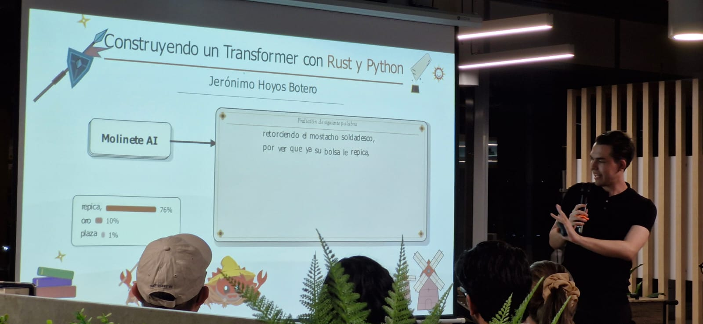

Este archivo es `posts/hola-mundo.md`. Está marcado como **borrador** (`draft: true`), así que no se publica. Úsalo como chuleta y bórralo cuando ya no lo necesites.

## Texto

Párrafos normales, **negrita**, *cursiva*, ~~tachado~~, `código en línea` y [enlaces](https://github.com/JeroHoyos).

> Las citas se ven así, con la letra serif de los títulos.

- Listas con guion
- y otra cosa
  - con sub-elementos

1. Listas numeradas
2. también

## Código

```rust
fn attention(q: &Tensor, k: &Tensor, v: &Tensor) -> Tensor {
    softmax(&(q.matmul(&k.t()) / d_k.sqrt())).matmul(v)
}
```

## Fórmulas

En línea, como $e^{i\pi} + 1 = 0$, o en bloque:

$$
\mathrm{Attention}(Q, K, V) = \mathrm{softmax}\left(\frac{QK^\top}{\sqrt{d_k}}\right)V
$$

## Tablas

| modelo | parámetros | pérdida |
| --- | ---: | ---: |
| GPT-2 small | 124M | 3.28 | 
| Molinete | 10M | 4.10 |

## Imágenes

Las imágenes van en `posts/img/` (el editor las pone ahí solo cuando las arrastras o pegas). Una imagen sola en su párrafo se vuelve figura con pie de foto:



---

Y eso es todo. El botón «Descargar PDF» de arriba imprime solo el artículo.
